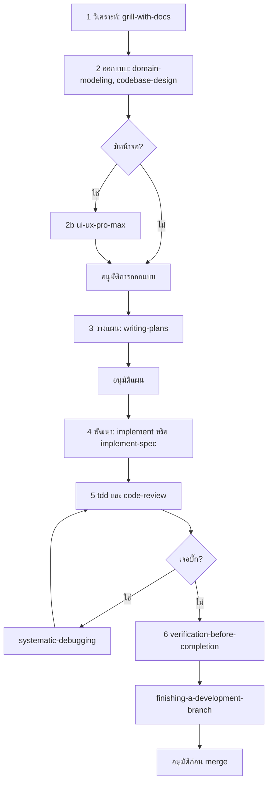

# คู่มือติดตั้ง AI Skills สำหรับโปรเจกต์ใหม่

คู่มือนี้ใช้ติดตั้งชุด skill ของ agent ใน Cursor ให้เหมือนกันทุกโปรเจกต์ โดยแต่ละขั้นของงานมี skill ที่รับผิดชอบเพียงตัวเดียว

Skill เป็นคำสั่งที่ agent อ่านตอนช่วยเขียนโค้ด ไม่ถูก build เข้าแอป และไม่เปลี่ยนพฤติกรรมของระบบที่รันอยู่

---

## 1. ชุดที่ใช้และหน้าที่

| ชุด | หน้าที่ | วิธีใช้ |
|---|---|---|
| [Matt Pocock Skills](https://github.com/mattpocock/skills) | วิเคราะห์โจทย์ ออกแบบ เขียนโค้ด เทส รีวิว | ติดตั้งเป็น skill |
| [Superpowers](https://github.com/obra/superpowers) | วางแผน ดีบัก ยืนยันผล ส่งมอบ | ติดตั้งเป็น skill (เลือกบางตัว) |
| [UI UX Pro Max](https://github.com/nextlevelbuilder/ui-ux-pro-max-skill) | ระบบดีไซน์ สี ฟอนต์ layout responsive accessibility | ติดตั้งเป็น skill (เฉพาะโปรเจกต์ที่มี UI) |
| [Karpathy Skills](https://github.com/multica-ai/andrej-karpathy-skills) | เขียนเท่าที่จำเป็น แก้เฉพาะจุด | ไม่ติดตั้ง ใส่หลักการลงไฟล์กฎแทน |

### ชุดที่ไม่ใช้

- **[Ponytail](https://github.com/dietrichgebert/ponytail):** ทำหน้าที่เดียวกับ Karpathy และมี `/ponytail-review` ที่ทับกับ `code-review` ของ Matt ใช้แทน Karpathy ได้ (ระดับ `lite` และห้ามใช้ `/ponytail-review`) ถ้า agent ยังเขียนโค้ดเกินจำเป็นบ่อย ห้ามใช้คู่กับ Karpathy
- **[Taste Skill](https://github.com/leonxlnx/taste-skill):** ทำมาสำหรับเว็บบริษัทหรือ landing page (hero, ภาพถ่าย, shader) ไม่เหมาะกับระบบ ERP หรือหน้า admin และจะสร้างระบบดีไซน์ชุดที่สองมาชนกับ UI UX Pro Max

### Skill ของ Superpowers ที่ไม่ติดตั้ง

| Skill | เหตุผล |
|---|---|
| `brainstorming` | ซ้ำกับ `grill-with-docs` และสั่งให้รันก่อนทุกงาน |
| `test-driven-development` | ซ้ำกับ `tdd` ที่ `implement` เรียกอยู่แล้ว |
| `requesting-code-review` | ซ้ำกับ `code-review` ที่ `implement` เรียกอยู่แล้ว |
| `executing-plans`, `subagent-driven-development` | ซ้ำกับ `implement` / `implement-spec` |
| `using-superpowers` | บังคับให้ทุกงานใช้ workflow ของ Superpowers ซึ่งจะชนกับลำดับในคู่มือนี้ |

---

## 2. ลำดับการทำงาน



| ขั้น | บทบาท | Skill | ผลลัพธ์ |
|---|---|---|---|
| 1 วิเคราะห์โจทย์ | System Architect | `grill-with-docs` (Matt) | ความต้องการ กฎธุรกิจ ข้อจำกัด ไม่มีคำถามค้าง |
| 2 ออกแบบระบบ | System Architect | `domain-modeling`, `codebase-design` (Matt) | ศัพท์ใน glossary, ADR, ขอบเขตโมดูล, ผลกระทบต่อฐานข้อมูล |
| 2b ออกแบบ UI | UI/UX Designer | `ui-ux-pro-max` | `design-system/<project>/MASTER.md` |
| 3 วางแผน | Senior Developer | `writing-plans` (Superpowers) | ขั้นงาน ไฟล์ที่จะแก้ วิธีตรวจแต่ละขั้น |
| 4 พัฒนา | Senior Developer | `implement` (หนึ่งงาน) / `implement-spec` (หลายงาน แบ่ง agent ย่อย) (Matt) | โค้ดตามแผน |
| 5 ทดสอบ | QA Engineer | `tdd` (Matt), `systematic-debugging` เมื่อเจอบั๊ก (Superpowers) | เทสผ่าน บั๊กมีเทสกันซ้ำ |
| 5b รีวิว | Code Reviewer | `code-review` (Matt) | ผลรีวิวด้านมาตรฐานและด้านสเปก |
| 6 ส่งมอบ | QA Engineer | `verification-before-completion`, `finishing-a-development-branch` (Superpowers) | หลักฐานว่าตรวจผ่านจริง แล้วเลือก merge / PR |

งานเล็กที่ระบุไฟล์และพฤติกรรมชัดแล้ว (แก้คำ, แก้บั๊กบรรทัดเดียว) ข้ามขั้น 1–3 ได้ แต่ต้องผ่านขั้น 6 เสมอ

---

## 3. สิ่งที่ต้องมีในเครื่อง

- Node.js 22.20 ขึ้นไป (สำหรับ `npx skills`)
- Python 3 (สำหรับสคริปต์ค้นหาของ UI UX Pro Max)
- Git และโปรเจกต์ต้องเป็น git repo (`finishing-a-development-branch` และ `code-review` อ่าน diff จาก git)

ตรวจสอบ:

```powershell
node --version
python --version
git status
```

---

## 4. ขั้นตอนติดตั้ง

รันทุกคำสั่งที่ root ของโปรเจกต์ ติดตั้งแบบรายโปรเจกต์ (ไม่ใส่ `-g`) เพื่อให้คนในทีมที่ clone repo ได้ชุดเดียวกัน

**ห้ามติดตั้งชุดเดียวกันซ้ำสองทาง** เช่น ติดตั้งปลั๊กอิน Cursor (`/add-plugin superpowers`) พร้อมกับ `npx skills add` เพราะ skill จะถูกโหลดซ้ำ

### 4.1 Matt Pocock

```powershell
npx skills@latest add mattpocock/skills --skill grill-me grill-with-docs grilling domain-modeling codebase-design implement implement-spec to-spec to-tickets tdd code-review setup-matt-pocock-skills -a cursor
```

- `grilling` ต้องมี เพราะ `grill-me` และ `grill-with-docs` เรียกใช้
- `to-spec` และ `to-tickets` ใช้สร้างสเปกและแตกงานให้ `implement-spec` ถ้าไม่ใช้ `implement-spec` ตัดออกได้

- เมื่อรันผ่าน agent ใน Cursor ตัวติดตั้งจะทำงานแบบไม่ถามเอง และติดตั้งลง `.agents/skills/` พร้อมสร้าง `skills-lock.json` (commit ไฟล์นี้ด้วย ใช้ตอน `npx skills update`)

จากนั้นผู้ใช้ต้องรันเองใน Cursor chat ครั้งเดียวต่อโปรเจกต์ (skill นี้ถามคำถามและห้าม agent เลือกแทน):

```
/setup-matt-pocock-skills
```

คำตอบที่แนะนำ:

- Issue tracker: local markdown (ไฟล์อยู่ใน `.scratch/`) หรือ GitHub ถ้าใช้ GitHub Issues จริง
- ไฟล์ที่จะเพิ่มบล็อก `## Agent skills`: `AGENTS.md` (ถ้ายังไม่มีทั้ง `AGENTS.md` และ `CLAUDE.md` skill จะถามให้เลือก)
- Domain docs: single-context (ค่าเริ่มต้น `GLOSSARY.md` ที่ root และ ADR ใน `docs/adr/`)
- Triage labels: ไม่ถาม เพราะไม่ได้ติดตั้ง `triage`

ผลลัพธ์อยู่ใน `docs/agents/`

### 4.2 Superpowers

```powershell
npx skills@latest add obra/superpowers --skill writing-plans systematic-debugging verification-before-completion finishing-a-development-branch -a cursor
```

ติดตั้งลง `.agents/skills/` เช่นกัน `writing-plans` บันทึกแผนที่ `docs/superpowers/plans/` และยังอ้างถึง skill ของ Superpowers ที่ไม่ได้ติดตั้ง ไฟล์กฎในหัวข้อ 5 จึงต้องมีส่วน "ตัวแทน skill ที่ไม่ได้ติดตั้ง"

### 4.3 UI UX Pro Max (เฉพาะโปรเจกต์ที่มี UI)

```powershell
npx ui-ux-pro-max-cli@latest init --ai cursor
```

ติดตั้งลง `.cursor/skills/` และ**แถม skill มาอีก 6 ตัว**: `banner-design`, `brand`, `design`, `design-system`, `slides`, `ui-styling` ซึ่ง `ui-ux-pro-max` ไม่ได้เรียกใช้ และเป็นงานแบรนด์ แบนเนอร์ และสไลด์ ให้ลบออก:

```powershell
"banner-design","brand","design","design-system","slides","ui-styling" | ForEach-Object { Remove-Item -Recurse -Force ".cursor\skills\$_" }
```

สร้างระบบดีไซน์ของโปรเจกต์ครั้งแรก (แก้คำค้นและชื่อโปรเจกต์ให้ตรงงาน):

```powershell
python .cursor/skills/ui-ux-pro-max/scripts/search.py "internal admin dashboard" --design-system --persist -p "ProjectName" -o . --density 6 --motion 2 --variance 2 -f markdown
```

- `--stack` เป็นโหมดค้นหาแยก ใช้คู่กับ `--design-system` ไม่ได้
- ผลลัพธ์อยู่ที่ `design-system/<project-slug>/MASTER.md` ถ้ามีหน้าที่ต้องต่างจากหลัก ให้สร้างไฟล์แยกด้วย `--page "<page-name>"`

**ต้องตรวจผลก่อนใช้เสมอ** ใน `line-price-ai` ผลที่ได้เป็นธีมมืด ฟอนต์ Fira (ไม่มีอักษรไทย) และแอนิเมชัน GSAP ซึ่งไม่ตรงกับแอปจริงที่เป็นธีมสว่าง สีเขียว และฟอนต์ Noto Sans Thai

- โปรเจกต์ที่มี UI อยู่แล้ว: เขียน `MASTER.md` ใหม่จากของจริง (`globals.css`, layout, class ที่ใช้บ่อย) และเก็บจากผลที่สร้างมาเฉพาะ checklist กับ anti-pattern
- โปรเจกต์ใหม่: ใช้ผลที่ได้เป็นจุดเริ่มต้นได้ แต่ต้องเช็กว่าฟอนต์รองรับภาษาไทย

### 4.4 ไฟล์กฎของโปรเจกต์

สร้าง `.cursor/rules/ai-workflow.mdc` จากเทมเพลตในหัวข้อ 5 แล้วกรอกส่วน "กฎเฉพาะโปรเจกต์"

### 4.5 ตรวจหลังติดตั้ง

1. Matt Pocock และ Superpowers อยู่ใน `.agents/skills/` (16 ตัว) ส่วน UI UX Pro Max อยู่ใน `.cursor/skills/` (1 ตัว) และไม่มีชื่อซ้ำกันสองที่:

   ```powershell
   Get-ChildItem .agents\skills, .cursor\skills | Select-Object -ExpandProperty Name | Group-Object | Where-Object Count -gt 1
   ```

2. เปิด Cursor chat ใหม่ พิมพ์ `/` แล้วต้องเห็น `grill-with-docs`, `writing-plans`, `implement`
3. ลบ skill ที่ไม่อยู่ในรายการของคู่มือนี้ออก ถ้า installer เลือกเกินมา
4. Commit `.agents/skills/`, `.cursor/skills/`, `skills-lock.json`, `.cursor/rules/ai-workflow.mdc` และ `design-system/` เข้า repo

### 4.6 ตัวรันเทส (ถ้ายังไม่มี)

`tdd` และ `verification-before-completion` ต้องมีคำสั่งเทสที่รันได้จริง สำหรับโปรเจกต์ Next.js / TypeScript:

```powershell
npm install -D vitest@^4
```

- Vitest 5 ต้องใช้ `@types/node` 22 ขึ้นไป ถ้าโปรเจกต์ยังใช้ `@types/node` 20 ให้ใช้ Vitest 4 แทนการบังคับติดตั้งด้วย `--force`
- เพิ่ม script `"test": "vitest run"` และ `"test:watch": "vitest"` ใน `package.json`
- เพิ่ม `vitest.config.ts` ที่ map alias `@` ไปที่ `./src` ให้ตรงกับ `tsconfig.json`
- เริ่มจากเทสฟังก์ชันที่ไม่มี side effect หนึ่งไฟล์ เพื่อยืนยันว่าตัวรันทำงาน

---

## 5. เทมเพลตไฟล์กฎ `.cursor/rules/ai-workflow.mdc`

คัดลอกทั้งบล็อก แล้วแก้ส่วนที่อยู่ใน `<...>`

```markdown
---
description: ลำดับการใช้ skill และกฎของโปรเจกต์
alwaysApply: true
---

# AI Workflow

## ลำดับงาน
1. โจทย์ยังไม่ชัด: `/grill-with-docs` จนไม่มีคำถามค้าง
2. ออกแบบ: `domain-modeling` และ `codebase-design` ถ้ามีหน้าจอให้อ่าน `design-system/<project>/MASTER.md` และใช้ `ui-ux-pro-max` จากนั้นหยุดรออนุมัติ
3. วางแผน: `/writing-plans` ระบุไฟล์ที่จะแก้และวิธีตรวจทุกขั้น บันทึกที่ `docs/superpowers/plans/` จากนั้นหยุดรออนุมัติ
4. พัฒนา: `/implement` (หนึ่งงาน) หรือ `/implement-spec` (หลายงาน)
5. บั๊ก: `/systematic-debugging` เท่านั้น
6. ก่อนบอกว่าเสร็จ: `verification-before-completion` แล้ว `finishing-a-development-branch` หยุดรออนุมัติก่อน merge

งานเล็กที่ผู้ใช้ระบุไฟล์และพฤติกรรมชัดแล้ว ข้ามขั้น 1–3 ได้ ขั้น 6 ข้ามไม่ได้

## ห้ามซ้ำซ้อน
- skill ของ Superpowers บางตัวไม่ได้ติดตั้งโดยตั้งใจ เมื่อ skill อ้างถึงให้ใช้ตัวแทนนี้:
  - `superpowers:subagent-driven-development` หรือ `superpowers:executing-plans` ใช้ `/implement` หรือ `/implement-spec`
  - `superpowers:test-driven-development` ใช้ `tdd`
  - `superpowers:requesting-code-review` ใช้ `code-review`
  - `superpowers:brainstorming` ใช้ `grill-with-docs`
  - `superpowers:using-git-worktrees` ไม่ใช้ ทำงานบน branch ปกติ
- TDD ใช้ `tdd` ชุดเดียว และ review ใช้ `code-review` ชุดเดียวต่องาน
- ระบบดีไซน์มีแหล่งเดียวคือ `design-system/<project>/MASTER.md`
- ห้ามสลับ workflow ดีบักกลางงาน

## หลักการเขียนโค้ด
- เขียนเท่าที่โจทย์ต้องการ ไม่เพิ่มฟีเจอร์ abstraction หรือ config ที่ไม่ได้ขอ
- แก้เฉพาะบรรทัดที่เกี่ยวกับงาน ไม่จัดรูปแบบ ไม่ refactor โค้ดข้างเคียง
- ลบเฉพาะของที่การแก้ของเราทำให้ไม่ถูกใช้ ถ้าเจอโค้ดตายเดิมให้แจ้ง ไม่ต้องลบ
- ห้ามตัด validation, การจัดการ error, ความปลอดภัย หรือ accessibility เพื่อให้โค้ดสั้นลง
- ไม่แน่ใจให้ถาม ไม่เดาแล้วทำต่อ

## กฎเฉพาะโปรเจกต์
- ฐานข้อมูล: <ตำแหน่งไฟล์ migration> ห้ามแก้ไฟล์ migration ที่มีอยู่ ถ้าต้องเปลี่ยนสคีมาให้เพิ่มไฟล์ใหม่เลขถัดไป และห้ามรันกับฐานข้อมูลจนกว่าผู้ใช้สั่ง
- โมดูลกลาง: <รายชื่อไฟล์ เช่น db, auth, permissions, middleware> ถ้าต้องแตะ แผนต้องระบุไว้ก่อนลงมือ
- การตรวจ: <คำสั่งที่ใช้ได้จริง เช่น npm run lint, npm run build, npm test> ห้ามอ้างว่าเทสผ่านถ้าไม่ได้รัน
- ไฟล์ลับ: ห้ามอ่านค่าใน `.env*` ไปแสดง และห้าม commit
```

---

## 6. Checklist สำหรับโปรเจกต์ใหม่

- [ ] เครื่องมี Node 22.20+, Python 3 และโปรเจกต์เป็น git repo
- [ ] ติดตั้ง Matt Pocock (หัวข้อ 4.1) และรัน `/setup-matt-pocock-skills`
- [ ] ติดตั้ง Superpowers 4 ตัว (หัวข้อ 4.2)
- [ ] ถ้ามี UI: ติดตั้ง UI UX Pro Max, ลบ 6 skill ที่แถมมา, สร้าง `MASTER.md` และตรวจให้ตรงกับแอปจริง (หัวข้อ 4.3)
- [ ] สร้าง `.cursor/rules/ai-workflow.mdc` และกรอกกฎเฉพาะโปรเจกต์
- [ ] ตรวจว่าไม่มี skill ซ้ำ และไม่ได้ติดตั้งชุดที่ตัดออก
- [ ] ถ้ายังไม่มีตัวรันเทส ให้เพิ่มตามหัวข้อ 4.6
- [ ] รันคำสั่งเทส lint และ build แล้วจดว่า error ไหนมีอยู่ก่อนติดตั้ง
- [ ] Commit ไฟล์ทั้งหมดเข้า repo

## 7. การอัปเดต

```powershell
npx skills@latest update
npx ui-ux-pro-max-cli update
```

หลังอัปเดตให้ตรวจหัวข้อ 4.5 อีกครั้ง เพราะเวอร์ชันใหม่อาจเพิ่มหรือเปลี่ยนชื่อ skill และ UI UX Pro Max อาจติดตั้ง skill ที่แถมมากลับเข้ามา
