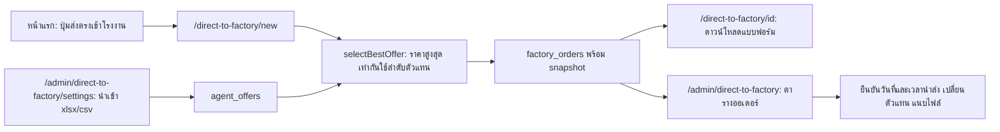


# ส่งตรงเข้าโรงงาน

**เป้าหมาย:** ลูกค้าที่ได้รับอนุมัติแจ้งส่งสินค้าเข้าโรงงานได้เอง และได้ไฟล์แบบฟอร์มของตัวแทนที่ให้ราคาดีที่สุด ส่วนพนักงานรับรายการไปยืนยันและปิดงานที่ `/admin/direct-to-factory`

**ข้อมูลอ้างอิง:** ภาพฟอร์มสองส่วน (ลูกค้า / ส.เจริญ) และภาพตารางข้อเสนอ (โรงงานปลายทาง, สินค้า, ชื่อตัวแทน, ราคาล่าสุด, เลข PO, เลขใบนำส่ง, ไฟล์ดาวน์โหลดแบบฟอร์ม) ที่ผู้ใช้ส่งมาในแชท

เมื่ออนุมัติแผนแล้ว ขั้นแรกให้คัดลอกแผนนี้ไปที่ `docs/superpowers/plans/2026-11-11-direct-to-factory.md`



## กฎที่ใช้ทั้งระบบ

- **ใครเป็นลูกค้า:** ผู้ใช้ที่มี `access_requests.status = 'approved'` และ `users.is_active = true` (เงื่อนไขเดียวกับ [src/app/admin/users/page.tsx](src/app/admin/users/page.tsx))
- **ใครเข้าหลังบ้าน:** มีสิทธิ์ใหม่ `manage_factory_orders` ให้เฉพาะ admin และ operator
- **ราคาดีที่สุด:** เลือกข้อเสนอที่เปิดใช้และราคาสูงสุด ถ้าราคาเท่ากัน เลือกตัวแทนที่ `agents.sort_order` น้อยกว่า ถ้าไม่มีไฟล์แบบฟอร์มก็ยังสร้างออเดอร์ได้
- **สิ่งที่ลูกค้าไม่เห็น:** ราคา, ตัวแทน, เลข PO และเลขใบนำส่ง ห้ามส่งค่าเหล่านี้ใน API หรือหน้าฝั่งลูกค้า
- **สิ่งที่ลูกค้าเห็น:** ข้อมูลที่ตัวเองกรอก, ไฟล์แบบฟอร์ม, วันที่ยืนยัน, เวลานำส่ง, โรงงานและสินค้าที่ยืนยัน, หมายเหตุพนักงาน, ไฟล์ใบนำส่ง, ไฟล์แนบ และสถานะ
- **การแก้หรือยกเลิกของลูกค้า:** ทำได้เมื่อยังไม่ได้ยืนยันวันที่ (`confirmed_date IS NULL`) และสถานะยังไม่ใช่ `cancelled` หรือ `completed`
- **สถานะ:**
  - `customer_submitted` แสดงว่า "ลูกค้าแจ้ง"
  - `pending` แสดงว่า "รอดำเนินการ"
  - `updated` แสดงว่า "อัพเดทข้อมูล"
  - `completed` แสดงว่า "จบรายการ"
  - `cancelled` แสดงว่า "ยกเลิก" (ใช้เมื่อลูกค้ายกเลิกเอง)
- **Snapshot:** ตอนสร้างออเดอร์ คัดลอกตัวแทน, ราคา, เลข PO, เลขใบนำส่ง และไฟล์แบบฟอร์มจากข้อเสนอลงออเดอร์ ถ้าราคาในตั้งค่าเปลี่ยนภายหลัง ออเดอร์เก่าไม่เปลี่ยนตาม
- **เลข PO และเลขใบนำส่ง:** พนักงานกรอกเอง ไม่ออกเลขอัตโนมัติ
- **LINE:** ยังไม่ส่งแจ้งเตือนในรอบนี้ ไม่แตะ [src/lib/line.ts](src/lib/line.ts)
- **ดีไซน์:** ตาม [design-system/line-price-ai/MASTER.md](design-system/line-price-ai/MASTER.md) ข้อความเป็นภาษาไทย ใช้ `.btn-primary`, `.card`, `.input` สถานะแสดงทั้งสีและข้อความ ราคาใช้ `tabular-nums`
- **Migration:** เพิ่มไฟล์ใหม่ใน `sql/migrations/` เท่านั้น ห้ามรันกับฐานข้อมูลจนกว่าผู้ใช้สั่ง

## ไฟล์ทั้งหมด

ฐานข้อมูล
- สร้าง `sql/migrations/013_create_direct_to_factory.sql`
- สร้าง `sql/migrations/014_add_direct_to_factory_log_actions.sql`

ตรรกะล้วนพร้อมเทสต์ใน `src/lib/direct-to-factory/`
- `select-offer.ts` + `select-offer.test.ts`
- `order-rules.ts` + `order-rules.test.ts`
- `import-rows.ts` + `import-rows.test.ts`
- `read-spreadsheet.ts` + `read-spreadsheet.test.ts`

ส่วนที่เรียกฐานข้อมูล
- `src/lib/direct-to-factory/customer-access.ts`
- `src/lib/direct-to-factory/queries.ts`
- `src/lib/direct-to-factory/files.ts`

โมดูลกลางที่ต้องแตะ (ระบุไว้ตามกฎโปรเจกต์)
- [src/lib/permissions.ts](src/lib/permissions.ts) เพิ่ม `manage_factory_orders` ใน type และให้ admin กับ operator
- [src/middleware.ts](src/middleware.ts) เพิ่ม `'/admin/direct-to-factory': 'manage_factory_orders'` ใน `PATH_TO_PERMISSION` และเพิ่มสิทธิ์ใน `DEFAULT_ROLE_PERMISSIONS` ของ admin กับ operator

ไฟล์อื่นที่แก้
- [src/app/admin/roles/RoleManager.tsx](src/app/admin/roles/RoleManager.tsx) เพิ่มรายการสิทธิ์ "จัดการส่งตรงเข้าโรงงาน" และใส่ในค่าเริ่มต้นของ operator
- [src/components/Navbar.tsx](src/components/Navbar.tsx) ปุ่ม "ส่งตรงเข้าโรงงาน" แสดงเมื่อ `canAccess('manage_factory_orders')` (worker จะไม่เห็นอีก)
- [src/lib/storage.ts](src/lib/storage.ts) เพิ่มพารามิเตอร์เลือกได้ `allowedTypes` ใน `uploadFile` ค่าเดิมยังเป็นรูปภาพเหมือนเดิม
- [src/app/api/files/[...path]/route.ts](src/app/api/files/[...path]/route.ts) ตอบ 404 เมื่อ segment แรกเป็น `direct-to-factory` เพื่อไม่ให้ไฟล์ออเดอร์เปิดผ่าน route สาธารณะนี้
- [src/app/page.tsx](src/app/page.tsx) เพิ่มปุ่ม "ส่งตรงเข้าโรงงาน" เฉพาะลูกค้าที่มีสิทธิ์
- `package.json` เพิ่ม dependency `exceljs`

หน้าและ API
- ฝั่งลูกค้า: `src/app/direct-to-factory/`, `src/app/api/direct-to-factory/`
- ฝั่งพนักงาน: `src/app/admin/direct-to-factory/` (แทนหน้าเปล่าเดิม), `src/app/api/admin/direct-to-factory/`

## งานที่ 1: สคีมาและสิทธิ์

`013_create_direct_to_factory.sql` สร้างตารางทั้งหมดด้วย `CREATE TABLE IF NOT EXISTS`

- **`factories`**: `id uuid`, `name text unique`, `is_active`, `sort_order`, `created_at`, `updated_at`
- **`factory_products`**: `id`, `factory_id` (FK), `name`, `is_active`, timestamps, `UNIQUE(factory_id, name)`
- **`agents`**: `id`, `name text unique`, `sort_order int`, `is_active`, timestamps
- **`agent_offers`**:
  - `id`, `product_id` (FK), `agent_id` (FK), `price numeric(12,2) NOT NULL`
  - `po_number text`, `delivery_note_number text`
  - `form_file_path text`, `form_file_name text`, `form_mime_type text`
  - `is_active`, timestamps, `UNIQUE(product_id, agent_id)`
- **`factory_orders`**:
  - ลูกค้า: `user_id` (FK), `delivery_date date NOT NULL`, `factory_id`, `product_id`, `license_plate text NOT NULL`, `customer_note`
  - snapshot: `offer_id`, `agent_id`, `price`, `po_number`, `delivery_note_number`, `form_file_path`, `form_file_name`, `form_mime_type`
  - พนักงาน: `confirmed_date date`, `delivery_time time`, `confirmed_factory_id`, `confirmed_product_id`, `staff_note`, `updated_by`
  - `status text NOT NULL DEFAULT 'customer_submitted' CHECK (status IN (...ห้าค่า))`, `cancelled_at`, timestamps
  - index บน `(user_id)`, `(status, created_at DESC)`, `(factory_id)`
- **`factory_order_files`**: `id`, `order_id` (FK cascade), `kind text CHECK (kind IN ('delivery_note','attachment'))`, `file_path`, `file_name`, `mime_type`, `file_size`, `uploaded_by`, `created_at`
- ท้ายไฟล์: `INSERT INTO role_permissions (role, permission) VALUES ('admin','manage_factory_orders'), ('operator','manage_factory_orders') ON CONFLICT DO NOTHING` (ตรวจ unique constraint ใน `002_create_role_permissions.sql` ก่อนเขียน)

`014_add_direct_to_factory_log_actions.sql` ใช้ `ALTER TYPE log_action ADD VALUE IF NOT EXISTS` เพิ่มค่าเหล่านี้
- `create_factory_order`, `update_factory_order`, `cancel_factory_order`
- `import_agent_offers`, `update_factory_settings`

จากนั้นแก้สิทธิ์ใน `permissions.ts`, `middleware.ts`, `RoleManager.tsx` และ `Navbar.tsx` ตามรายการไฟล์ด้านบน

**ตรวจ:** `npm run lint` (ไฟล์ที่แก้ต้องไม่มี error), `npx tsc --noEmit`, `npm test`

## งานที่ 2: ตรรกะล้วน (ใช้ skill `tdd` เขียนเทสต์ก่อน)

**`select-offer.ts`**

```ts
export interface OfferCandidate { offerId: string; agentId: string; agentSortOrder: number; price: number; isActive: boolean; }
export function selectBestOffer(offers: OfferCandidate[]): OfferCandidate | null
```

เทสต์ต้องครอบ
- ราคาสูงสุดชนะ เช่น ตัวแทน 2 ที่ 9.73 ชนะตัวแทน 1 ที่ 9.00 (ตามภาพ)
- ราคาเท่ากัน ตัวแทนที่ `sort_order` น้อยกว่าชนะ แม้จะอยู่ท้ายอาร์เรย์
- ข้อเสนอที่ปิดใช้ไม่ถูกเลือก
- อาร์เรย์ว่าง หรือปิดใช้ทั้งหมด คืน `null`

**`order-rules.ts`**
- `ORDER_STATUSES` และ `ORDER_STATUS_LABELS` (ป้ายภาษาไทย)
- `canCustomerEdit(order)` ตามกฎในหัวข้อกฎที่ใช้ทั้งระบบ
- `toCustomerView(order)` เลือกเฉพาะช่องที่ลูกค้าเห็นได้ เทสต์ต้องยืนยันว่าผลลัพธ์ไม่มี `price`, `agent_id`, `po_number`, `delivery_note_number`, `offer_id`

**`import-rows.ts`**

```ts
parseOfferRows(rows: string[][]): { rows: ParsedOfferRow[]; errors: { line: number; message: string }[] }
```

- หัวคอลัมน์ต้องมี `โรงงานปลายทาง`, `สินค้า`, `ชื่อตัวแทน`, `ราคาล่าสุด`
- คอลัมน์ `เลข PO` และ `เลขใบนำส่ง` มีหรือไม่มีก็ได้
- ไม่สนใจคอลัมน์ `ไฟล์ดาวโหลดแบบฟอร์ม` และคอลัมน์อื่นที่ไม่รู้จัก
- ตัดช่องว่างหัวท้าย ข้ามแถวที่ว่างทั้งแถว
- ราคาต้องเป็นตัวเลขไม่ติดลบ รองรับ `9.00` และ `1,234.50`
- ถ้าโรงงาน + สินค้า + ตัวแทน ซ้ำในไฟล์เดียว รายงานเป็น error
- PO หรือเลขใบนำส่งที่ว่าง เก็บเป็น `null` ซึ่งหมายถึงไม่เปลี่ยนค่าเดิม

**`read-spreadsheet.ts`**
- `readSpreadsheet(buffer, fileName): Promise<string[][]>` ใช้ `exceljs`
- `.xlsx` อ่านชีตแรก, `.csv` รองรับ UTF-8 ที่มี BOM
- นามสกุลอื่นให้ throw
- เทสต์สร้างไฟล์ xlsx และ csv ในหน่วยความจำ แล้วอ่านกลับมาได้ข้อมูลเดิม

**ตรวจ:** `npm test` ผ่านครบ และเห็นเทสต์ใหม่ทุกตัวในผลลัพธ์

## งานที่ 3: ตั้งค่าพื้นฐานและนำเข้าราคา (หลังบ้าน)

**หน้า**
- `src/app/admin/direct-to-factory/layout.tsx` แสดงแท็บลิงก์ "ตารางออเดอร์" (`/admin/direct-to-factory`) และ "ตั้งค่าพื้นฐาน" (`/admin/direct-to-factory/settings`)
- `settings/page.tsx` แบ่งเป็นสามส่วน
  - **โรงงาน:** เพิ่ม, แก้ชื่อ, เปิดหรือปิดใช้
  - **ตัวแทน:** เพิ่ม, แก้ชื่อ, เลื่อนลำดับขึ้นลง (ลำดับนี้ใช้ตัดสินเมื่อราคาเท่ากัน), เปิดหรือปิดใช้
  - **สินค้าและข้อเสนอ:** กรองตามโรงงาน แต่ละแถวแก้ราคา, เลข PO, เลขใบนำส่ง และเปิดหรือปิดใช้ได้ อัปโหลดหรือแทนที่ไฟล์แบบฟอร์มทีละแถว และมีปุ่ม "นำเข้า Excel/CSV"

**API** ใต้ `src/app/api/admin/direct-to-factory/` ทุก route ตรวจ `hasPermission(session.user.role, 'manage_factory_orders')` แบบเดียวกับ [src/app/api/admin/branches/route.ts](src/app/api/admin/branches/route.ts) และบันทึก log ด้วย `logActionWithIp`
- `factories`, `factories/[id]`
- `agents`, `agents/[id]`
- `offers`, `offers/[id]`
- `offers/[id]/form` รับ POST สำหรับอัปโหลด และ GET สำหรับดาวน์โหลด
- `import` รับ POST แบบ multipart

**การนำเข้า** (`import`)
1. อ่านไฟล์ด้วย `readSpreadsheet` แล้วแปลงด้วย `parseOfferRows`
2. ถ้ามี error แม้แถวเดียว ไม่บันทึกอะไรเลย และส่งรายการ error ที่ระบุเลขแถวกลับไป
3. ถ้าไม่มี error บันทึกทั้งหมดใน `transaction()` จาก `src/lib/db.ts`
   - upsert โรงงานตามชื่อ, สินค้าตาม (โรงงาน, ชื่อ), และตัวแทนตามชื่อ ตัวแทนใหม่ต่อท้ายลำดับ
   - upsert ข้อเสนอตาม (สินค้า, ตัวแทน): อัปเดตราคาทุกครั้ง แต่อัปเดต PO และเลขใบนำส่งเฉพาะเมื่อค่าไม่ว่าง
   - ไม่ลบแถวที่ไม่มีในไฟล์
4. ตอบกลับจำนวนที่สร้างใหม่และจำนวนที่อัปเดต

**ไฟล์** (`src/lib/direct-to-factory/files.ts`)
- อัปโหลดด้วย `uploadFile(file, 'direct-to-factory', ALLOWED)` โดย ALLOWED คือ pdf, xlsx, xls, docx, doc, jpg, png, webp
- ดาวน์โหลดผ่าน route ที่ตรวจสิทธิ์เท่านั้น ส่ง `Content-Disposition: attachment; filename*=UTF-8''<ชื่อเดิม encode>` และ `Cache-Control: private, no-store`
- ป้องกัน path traversal โดยอ่านไฟล์จาก path ที่เก็บในฐานข้อมูลเท่านั้น ไม่ใช้ค่าจาก URL

**ตรวจ:**
- `npm run lint`, `npx tsc --noEmit`, `npm test`
- หลังผู้ใช้รัน migration แล้ว นำเข้าไฟล์ตัวอย่างตามภาพ (Prime, SUS 201–213, ตัวแทน 1 และ 2) ต้องได้ 26 ข้อเสนอ
- นำเข้าไฟล์เดิมซ้ำ จำนวนข้อเสนอต้องไม่เพิ่ม
- ไฟล์ที่ราคาผิดหนึ่งแถว ต้องถูกปฏิเสธทั้งไฟล์ พร้อมบอกเลขแถว
- ผู้ใช้ worker เปิด `/admin/direct-to-factory` แล้วถูกส่งกลับ `/admin`

## งานที่ 4: ฝั่งลูกค้า

**การตรวจสิทธิ์:** `customer-access.ts` มีฟังก์ชัน `isApprovedCustomer(userId)` สำหรับเช็คว่าเป็นลูกค้าที่มีสิทธิ์ ทุกหน้าและ API ฝั่งลูกค้าเรียกฟังก์ชันนี้ ถ้าไม่ผ่านให้ redirect หรือตอบ 403

**หน้า**
- **หน้าแรก** [src/app/page.tsx](src/app/page.tsx): เพิ่มการ์ดปุ่ม "ส่งตรงเข้าโรงงาน" ไป `/direct-to-factory`
- **`/direct-to-factory`:** รายการของฉัน (ใหม่ไปเก่า) แสดงวันที่ส่ง, โรงงาน, สินค้า, ทะเบียน และป้ายสถานะ พร้อมปุ่ม "แจ้งส่งสินค้าใหม่"
- **`/direct-to-factory/new`:**
  - ชื่อลูกค้าแสดงจาก session แก้ไม่ได้
  - วันที่ส่ง ใช้ `input type="date"`
  - โรงงาน แสดงเฉพาะที่เปิดใช้และมีข้อเสนอเปิดใช้อย่างน้อยหนึ่งรายการ
  - สินค้า กรองตามโรงงานที่เลือก
  - ทะเบียนรถ (บังคับ) และหมายเหตุ
  - ทุกช่องมี `label` และข้อความ error ใต้ช่อง
- **`/direct-to-factory/[id]`:** แสดงข้อมูลจาก `toCustomerView`
  - ปุ่ม "ดาวน์โหลดแบบฟอร์มเข้าโรงงาน" เมื่อมีไฟล์ ถ้าไม่มีแสดงว่า "เจ้าหน้าที่จะแนบเอกสารให้ภายหลัง"
  - รายการไฟล์ใบนำส่งและไฟล์แนบ
  - ปุ่มแก้ไขและยกเลิก แสดงเฉพาะเมื่อ `canCustomerEdit` (ยกเลิกต้องมี modal ยืนยัน)

**API** ใต้ `src/app/api/direct-to-factory/`
- `options` (GET): ส่งเฉพาะโรงงานและสินค้า ไม่มีราคา
- `orders` (GET ของตัวเอง, POST สร้าง)
  - POST หาข้อเสนอของสินค้าแล้วเรียก `selectBestOffer`
  - บันทึก snapshot และบันทึก log `create_factory_order`
  - ถ้าสินค้าไม่มีข้อเสนอเปิดใช้ ตอบ 400
- `orders/[id]` (GET, PATCH, DELETE)
  - เป็นของเจ้าของเท่านั้น
  - PATCH และ DELETE ต้องผ่าน `canCustomerEdit` ไม่ผ่านตอบ 409
  - ถ้าแก้สินค้า เลือกข้อเสนอใหม่แล้วอัปเดต snapshot
  - DELETE ตั้งสถานะเป็น `cancelled` และใส่ `cancelled_at` ไม่ลบแถว
- `orders/[id]/form` และ `orders/[id]/files/[fileId]` (GET ดาวน์โหลด): เฉพาะเจ้าของหรือพนักงาน
- ทุก response ฝั่งลูกค้าผ่าน `toCustomerView`

**ตรวจ:**
- `npm run lint`, `npx tsc --noEmit`, `npm test`
- ล็อกอินเป็นลูกค้าที่อนุมัติแล้ว
  - สร้างรายการ SUS 201 ได้แบบฟอร์มของตัวแทน 2
  - response ของ API ไม่มีราคาหรือตัวแทน (ตรวจใน Network tab)
  - แก้และยกเลิกได้ก่อนพนักงานยืนยัน
- ผู้ใช้ที่ยังไม่อนุมัติ ไม่เห็นปุ่มบนหน้าแรก และ API ตอบ 403
- เปิด URL ไฟล์ผ่าน `/api/files/direct-to-factory/...` ได้ 404

## งานที่ 5: ตารางออเดอร์ (หลังบ้าน)

**หน้ารายการ** `src/app/admin/direct-to-factory/page.tsx` (แทนหน้าเปล่าเดิม)
- กรองด้วย search params: สถานะ, ช่วงวันที่ส่ง, โรงงาน, และคำค้นจากชื่อลูกค้าหรือทะเบียน
- คอลัมน์: วันที่แจ้ง, ลูกค้า, วันที่ส่ง, โรงงาน, สินค้า, ทะเบียน, ตัวแทน, ราคา, สถานะ
- แบ่งหน้าครั้งละ 20 รายการ

**หน้ารายละเอียด** `orders/[id]/page.tsx`
- ส่วนลูกค้า แสดงอย่างเดียว
- ส่วน ส.เจริญ เป็นฟอร์ม
  - วันที่ยืนยัน และเวลานำส่ง (`input type="time"`)
  - โรงงานและสินค้าที่ยืนยัน
  - ตัวแทน: dropdown ข้อเสนอของสินค้า แสดงราคาและลำดับ โดยตัวที่ระบบแนะนำมีป้าย "ราคาดีที่สุด"
  - เลข PO, เลขใบนำส่ง, หมายเหตุ, สถานะ
  - อัปโหลดไฟล์ใบนำส่งและไฟล์แนบ พร้อมลบไฟล์ได้
- เปลี่ยนตัวแทนแล้ว ระบบเติมราคา, PO, เลขใบนำส่ง และไฟล์แบบฟอร์มจากข้อเสนอใหม่ลงฟอร์ม พนักงานแก้ต่อได้ก่อนกดบันทึก
- ออเดอร์ที่สถานะ `cancelled` เปิดดูได้อย่างเดียว

**API** ใต้ `src/app/api/admin/direct-to-factory/`
- `orders` (GET) และ `orders/[id]` (GET, PATCH)
- `orders/[id]/files` (POST) และ `orders/[id]/files/[fileId]` (DELETE)
- ตรวจ `manage_factory_orders` ทุก route
- PATCH บันทึก log `update_factory_order` พร้อมรายชื่อช่องที่เปลี่ยน

**ตรวจ:**
- `npm run lint`, `npx tsc --noEmit`, `npm test`
- ในเบราว์เซอร์ด้วยบัญชี operator
  - ยืนยันวันที่และเวลาแล้ว ฝั่งลูกค้าเห็นค่าที่ยืนยัน และปุ่มแก้ไขหายไป
  - เปลี่ยนตัวแทนแล้ว ไฟล์แบบฟอร์มฝั่งลูกค้าเปลี่ยนตาม
  - แนบไฟล์ใบนำส่งแล้ว ลูกค้าดาวน์โหลดได้
  - เลข PO ไม่โผล่ฝั่งลูกค้า
- ตรวจที่ความกว้าง 375px: ตารางเลื่อนแนวนอนได้ และฟอร์มไม่ล้นจอ

## ก่อนบอกว่าเสร็จ

- ใช้ skill `verification-before-completion` รัน `npm test`, `npm run lint` และ `npm run build` (หยุด dev server ก่อน build) แล้วรายงานผลจริง lint เดิมมี error อยู่แล้ว 25 รายการในไฟล์อื่น ให้ยืนยันว่าไฟล์ใหม่และไฟล์ที่แก้ไม่มี error
- ใช้ skill `code-review` หนึ่งรอบ
- ใช้ skill `finishing-a-development-branch` แล้วหยุดรออนุมัติก่อน merge

## ความเสี่ยงที่ต้องระวังตอน review

- ราคา, ตัวแทน หรือ PO หลุดไปฝั่งลูกค้าผ่าน API ที่ลืมเรียก `toCustomerView`
- ลูกค้าคนหนึ่งเปิดออเดอร์หรือไฟล์ของคนอื่นได้ด้วยการเดา id ทุก query ต้องกรองด้วย `user_id`
- การนำเข้าแค่บางส่วนแล้วล้มกลางทาง ต้องอยู่ใน `transaction()` เสมอ
- ไฟล์ CSV ภาษาไทยที่บันทึกจาก Excel อาจไม่ใช่ UTF-8 ถ้าอ่านแล้วอักษรเพี้ยน ให้แจ้งผู้ใช้บันทึกเป็น "CSV UTF-8"
- `/api/files` เดิมเปิดทุกไฟล์ใน `UPLOAD_DIR` โดยไม่ตรวจสิทธิ์ งานนี้ปิดเฉพาะโฟลเดอร์ `direct-to-factory` ส่วนไฟล์อื่นเป็นของเดิม ให้แจ้งผู้ใช้ ไม่แก้ในงานนี้
